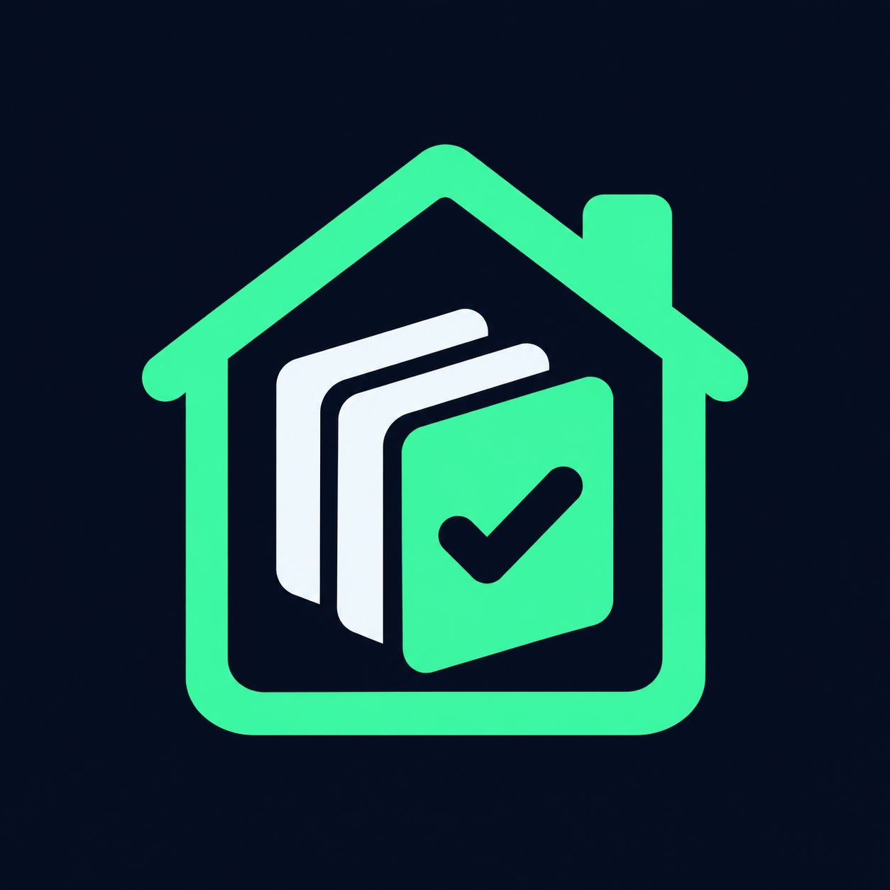

<div align="center">
  
  <h1>Home Installdeck</h1>
  <p><strong>Your installed games. Right at home.</strong></p>
  <p>A Decky Loader plugin for a focused Steam Deck home carousel.</p>
  <p>
    
    
    
  </p>
  <p><a href="https://github.com/Rodiosfo/Home-Installdeck/releases/download/v0.1.2/Installed-Home-0.1.2.zip"><strong>Download plugin</strong></a> · <a href="#installation">Install</a> · <a href="#development">Develop</a> · <a href="docs/README.es.md">Español</a></p>
</div>

---

Home Installdeck filters Steam's native home carousel to show locally installed Steam games and the non-Steam shortcuts you choose. Keep the familiar cards, controls and theme styling, with a simpler selection of games ready to play.

> **Preview release.** Version 0.1.2 passed type checking, compilation and 21 automated tests. Hardware validation on Steam Deck is still pending; automated tests do not establish compatibility with every Steam update or CSS Loader theme.

## What it does

| Feature | Behavior |
| --- | --- |
| Local Steam games | Shows games and demos installed on this device. Remote installations do not count. |
| Non-Steam selection | Choose which registered shortcuts appear with individual toggles. Selections save automatically. |
| Automatic checks | Checks supported executable, ROM and Heroic installation records before a manual choice is made. |
| Native carousel | Preserves the original carousel component and its launch callbacks. |
| Theme friendly | Injects no CSS. Designed to coexist with CSS Loader. |
| Refresh | Reads library changes periodically, on resume and through a manual refresh button. |

The filter applies to the **main home carousel**. Other Steam home sections remain available. It does not import games into Steam or install and uninstall games.

## Installation

1. Install [Decky Loader](https://github.com/SteamDeckHomebrew/decky-loader) on your Steam Deck.
2. Download [Installed-Home-0.1.2.zip](https://github.com/Rodiosfo/Home-Installdeck/releases/download/v0.1.2/Installed-Home-0.1.2.zip) and leave it zipped.
3. In Decky settings, enable developer mode and use **Install Plugin from ZIP** in the developer section. Labels may vary by Decky version.
4. Open **Installed Home** in Decky and enable **Activar filtro**.
5. Return to Steam Home. If the carousel has not refreshed, visit Library and return, or restart Steam when prompted.

**Plugin name:** it appears as **Installed Home** in Decky. The existing name is retained so updates keep the same plugin identity and settings. The current settings interface is in Spanish.

### Choose your non-Steam games

Open **Installed Home → Juegos externos en Inicio** and toggle the games you want to show. Use **Actualizar lista** to refresh the list.

- Manual selection takes priority over automatic installation detection.
- A selected shortcut can remain visible after its game is removed. Turn its toggle off after uninstalling.
- Games must already be registered in **Steam Library → Non-Steam**. A game installed only in Heroic or another launcher will not be imported by this plugin.

### Updating

Install the newer plugin ZIP over the existing version. Your saved choices are retained. The source archive generated by GitHub is for development; install the dedicated plugin ZIP above.

## CSS Loader compatibility

Home Installdeck changes the carousel's game list while preserving its native styling and callbacks. It does not inject styles or edit CSS Loader themes. When the filtered list is empty, the carousel is omitted.

Themes that depend on a specific card count, and plugins that replace the same carousel, can still conflict. Compatibility with your particular theme must be checked on your device. Steam's private UI interfaces can also change between updates.

## Troubleshooting

**A game is missing**

First check whether it appears in Steam's own library. For a non-Steam game, register its shortcut through your launcher, then refresh the plugin and enable its toggle. Heroic's desktop shortcut feature and its **Add to Steam** feature are different actions.

**A game crashes or opens twice**

Disable the filter and test the same shortcut from Steam's library. Include both results when reporting the issue. The plugin does not directly execute games, but this alone does not rule out an integration defect.

**Restore the stock carousel**

Turn off **Activar filtro** or uninstall the plugin through Decky. If Steam's UI remains stale after unloading, restart Steam.

## Development

The release was built using Node.js 24.19.0, pnpm 11.25.0 and Python 3.12.14. Dependencies are pinned in the lockfile.

```sh
pnpm install --frozen-lockfile
pnpm typecheck
pnpm test
pnpm build
python3 -m unittest discover -s tests -p 'test_*.py' -v
python3 scripts/package.py
```

The packaging command creates a Decky installation ZIP under `release/`.

| File | Responsibility |
| --- | --- |
| `src/model.ts` | Selection, local installation rules and ordering |
| `src/steam.ts` | Library discovery and shortcut details |
| `src/controller.ts` | Refreshes, settings and backend communication |
| `src/home.tsx` | Native home carousel integration |
| `src/index.tsx` | Decky settings panel |
| `main.py` | Local file checks and settings persistence |

### Validation

The existing test suite covers 10 frontend cases and 11 Python backend cases, including shortcut discovery, manual selection, local versus remote installations, temporary file checks and simulated React integration. Real controller navigation, suspend/resume and theme combinations require device testing.

## Contributing

See [CONTRIBUTING.md](CONTRIBUTING.md). Bug reports should include SteamOS, Steam, Decky and plugin versions, reproduction steps and whether the issue also occurs with the filter disabled.

## Credits & license

BSD 3-Clause for the plugin, with separate notices for bundled dependencies. See [LICENSE](LICENSE), [NOTICE.md](NOTICE.md) and [licenses/](licenses/).

Built on Decky Loader's plugin ecosystem, with home carousel integration adapted from [Deck Shelves](https://github.com/santojon/Deck-Shelves). This is an independent project and is not affiliated with Valve, Decky Loader, CSS Loader or Heroic.
